<p align="center">
  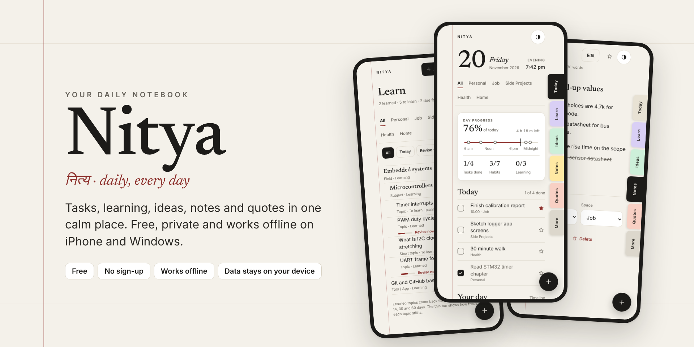
</p>

<h1 align="center">Nitya</h1>

<p align="center">
  <b>A free and private daily notebook for iPhone and Windows.</b><br>
  Tasks, learning, ideas, notes, quotes, goals and routine in one calm place. Works offline. No sign-up.
</p>

<p align="center">
  
  
  
  
  
</p>

<p align="center">
  <a href="https://madhavlathigara.github.io/nitya/"><b>👉 Open the app</b></a>
  &nbsp;·&nbsp; <a href="#-install">Install</a>
  &nbsp;·&nbsp; <a href="#-features">Features</a>
  &nbsp;·&nbsp; <a href="#-screenshots">Screenshots</a>
  &nbsp;·&nbsp; <a href="#-faq">FAQ</a>
</p>

---

## 💡 Why this app?

- 📓 **One notebook for everything.** Daily tasks, things to learn, new ideas, notes, quotes, goals and habits, for both personal life and job work.
- 🧠 **Helps you remember what you learn.** Learned topics come back for revision at the right time, and fade when you may be forgetting them.
- 🔒 **100% private.** Your data is saved only on your own device. There is no account, no server, no ads and no tracking.
- 📴 **Works offline.** After the first open, it works without internet.
- 📱 **Installs like a real app.** It runs on iPhone and Windows. No App Store needed.

*Nitya* (नित्य) is Sanskrit for **daily, every day**.

---

## ✨ Features

### 📅 Today
- Big date, part of the day and the time.
- **Day progress** bar from 6 am to midnight, with a dot for each planned item and quick numbers: tasks done, habits, learning.
- **Today list** with tick boxes. Tap the ☆ to mark a task as important.
- **Your day** timeline: times are written in the red notebook margin, with a **NOW** line at the current time. Morning routine, tasks, learning, revision and evening routine sit at their time.
- The idea you are working on, and a **quote of the day**.

### 📚 Learn
- Build your own learning tree: **Field → Subject → Topic → Short topic**, plus **Tools / Apps** to learn.
- Plan a topic for a day and time, with how many minutes it takes.
- Mark a topic as learned. It comes back for **revision after 1, 3, 7, 14, 30 and 60 days**.
- A small bar shows how fresh each topic still is. Topics due for revision look **faded** until you revise them.
- Filters: All, Today, Revise, Important.

### 💡 Ideas
- Each idea has **features**, and each feature has **options**.
- Move an idea through stages: **Seed → Exploring → Building → Launched**, or **Park** it for later.

### 📝 Notes
- Works like iPhone Notes: folders, pinned notes, search.
- Headings, bold, bullet lists and **tappable checklists**.
- Saves while you type. The first line becomes the title.

### ❝ Quotes
- Save only quotes: the words, who said it, where it is from, and tags.
- Favourites and a quote of the day.

### ✅ Tasks, Goals & Aims
- Tasks grouped as Overdue, Today, Upcoming, No date, Someday and Done this week.
- **Aims** are big directions. **Goals** sit under them. Link tasks to a goal and its progress fills in by itself.

### 🔁 Routine
- Morning and evening habits, last 7 days at a glance, and streaks.

### ✏️ Diagrams & Sketches
- Draw by hand with your finger, mouse or Apple Pencil: ink, red and blue pens, eraser, undo.
- Or save a photo of a diagram.

### 🗂️ More
- **Inbox** for quick thoughts, sorted later into tasks, learning, ideas, notes or quotes.
- **Done log** of everything finished in the last 30 days.
- **Weekly review**: week numbers, move open tasks, and write a short reflection.
- **Spaces**: Personal, Job, Side Projects, Health, Home. Rename them or add your own.

### 🎨 Look & feel
- A calm paper-notebook design with notebook tabs on the side.
- 6 colour templates: **Paper** (default), **White**, **Stone**, **Sand**, **Graphite** (dark) and **Midnight** (dark).
- Small, calm animations: ticks that draw themselves, a line through finished tasks, a filling progress bar, faded topics that come back when revised.

### 💾 Backup, export & calendar
- Save a backup file and restore it on any device.
- Export everything as **Markdown**.
- Export planned tasks and learning to your **calendar** (.ics file).

---

## 📸 Screenshots

<table>
  <tr>
    <td align="center">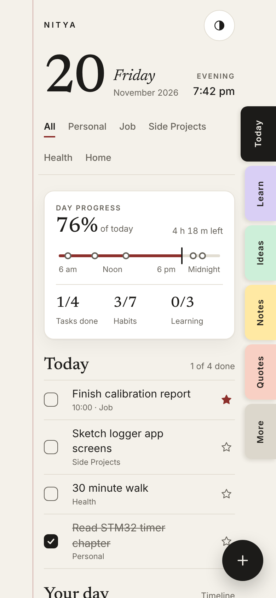<br><sub><b>Today</b></sub></td>
    <td align="center">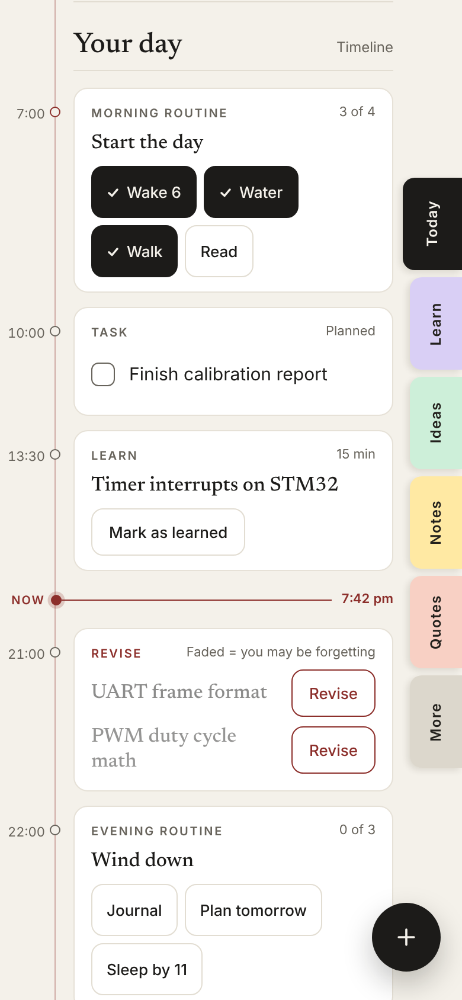<br><sub><b>Your day timeline</b></sub></td>
    <td align="center">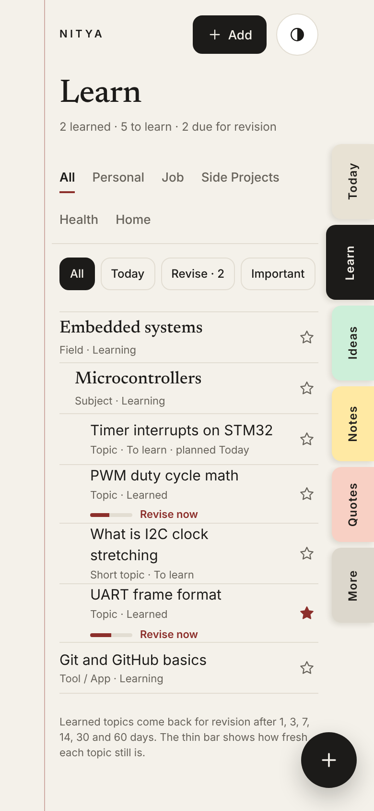<br><sub><b>Learn</b></sub></td>
  </tr>
  <tr>
    <td align="center">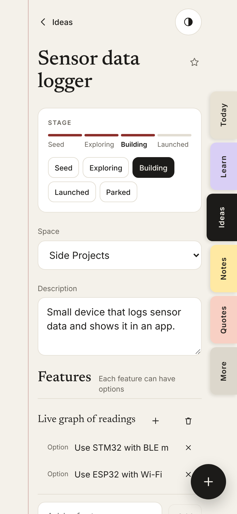<br><sub><b>An idea</b></sub></td>
    <td align="center">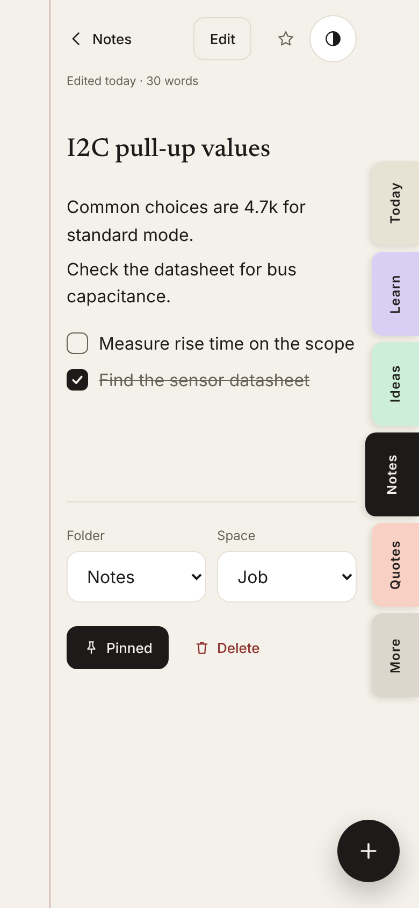<br><sub><b>A note</b></sub></td>
    <td align="center">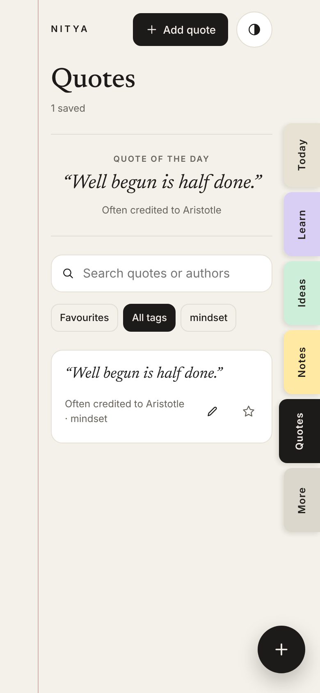<br><sub><b>Quotes</b></sub></td>
  </tr>
  <tr>
    <td align="center">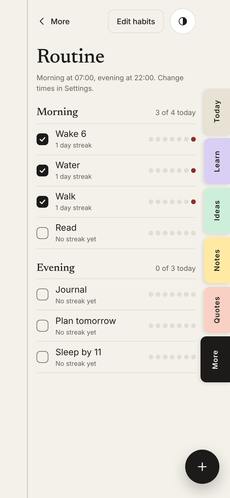<br><sub><b>Routine</b></sub></td>
    <td align="center">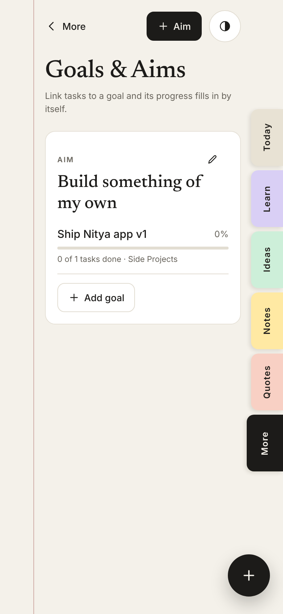<br><sub><b>Goals & Aims</b></sub></td>
    <td align="center">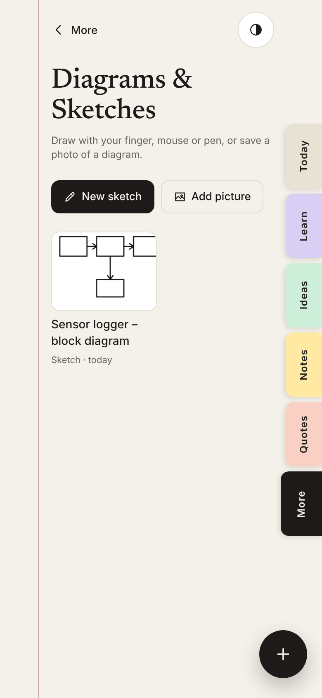<br><sub><b>Diagrams & Sketches</b></sub></td>
  </tr>
</table>

<details>
<summary><b>More screenshots: colour templates, new entry, settings, Windows</b></summary>
<br>
<table>
  <tr>
    <td align="center">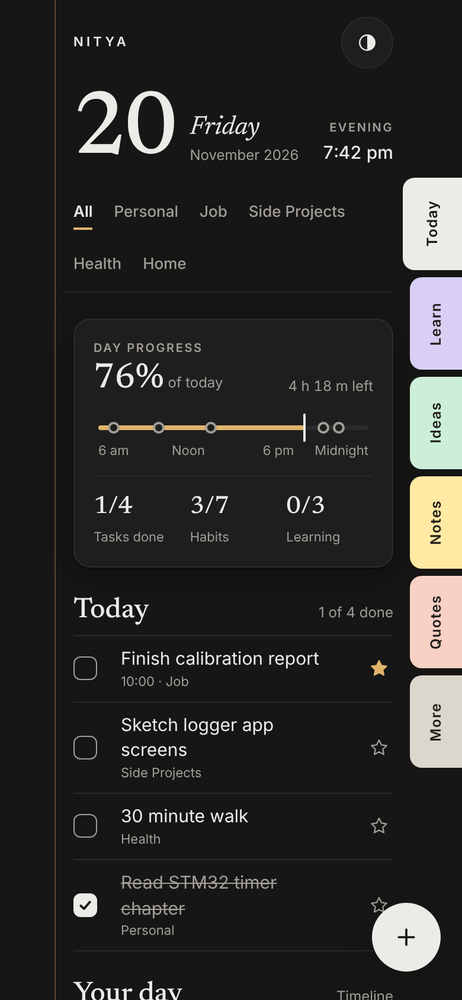<br><sub>Graphite (dark)</sub></td>
    <td align="center">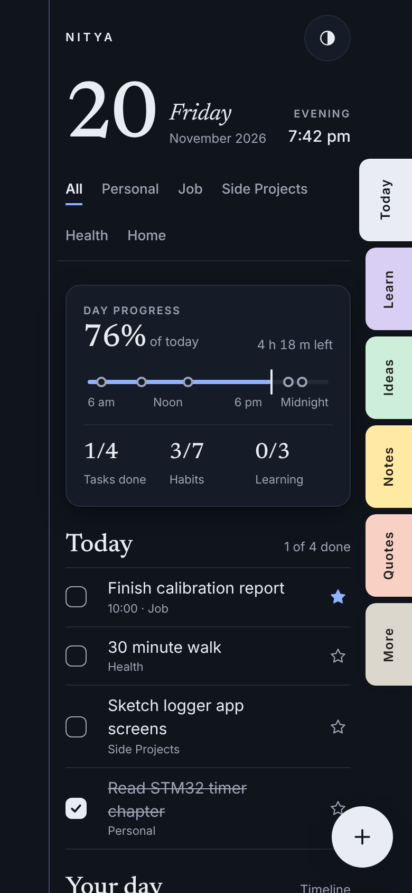<br><sub>Midnight (dark)</sub></td>
    <td align="center">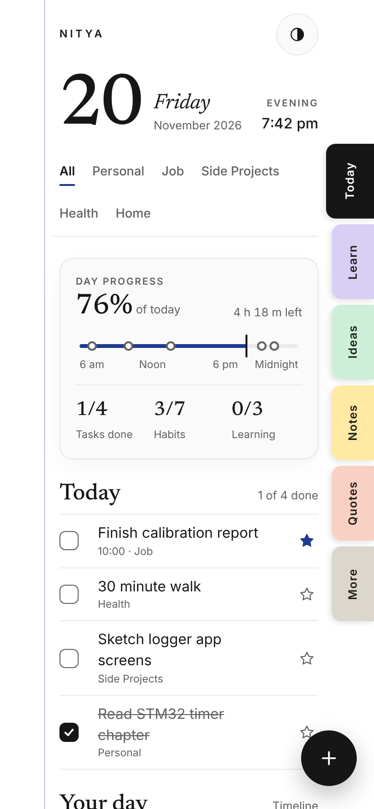<br><sub>White</sub></td>
  </tr>
  <tr>
    <td align="center">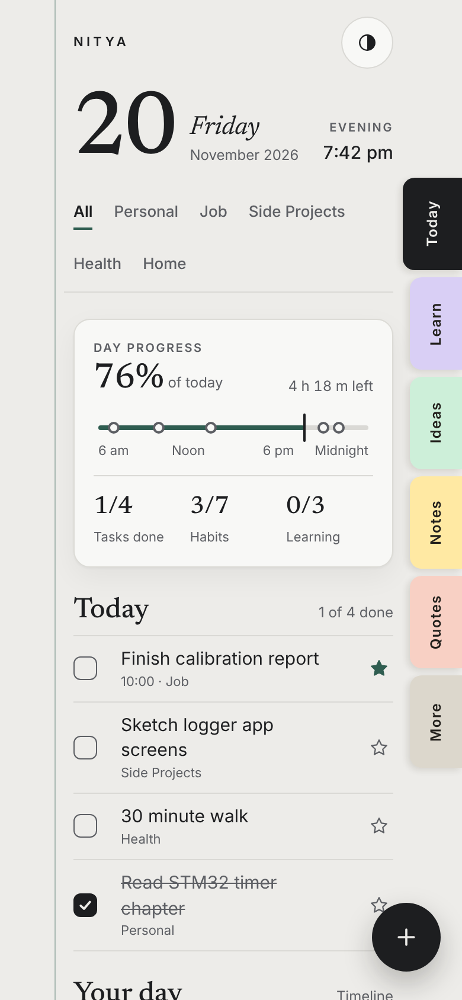<br><sub>Stone</sub></td>
    <td align="center">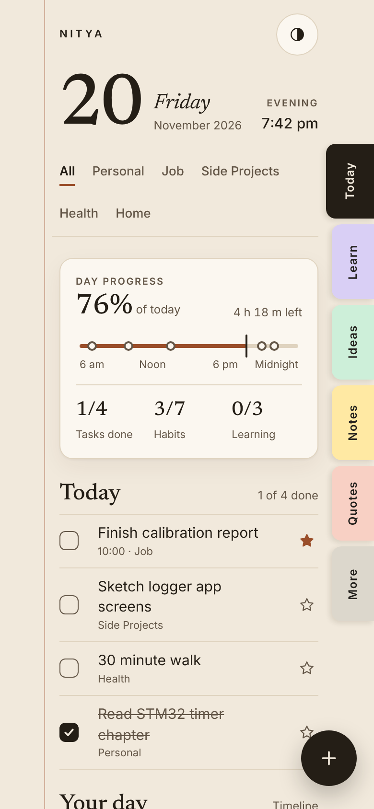<br><sub>Sand</sub></td>
    <td align="center">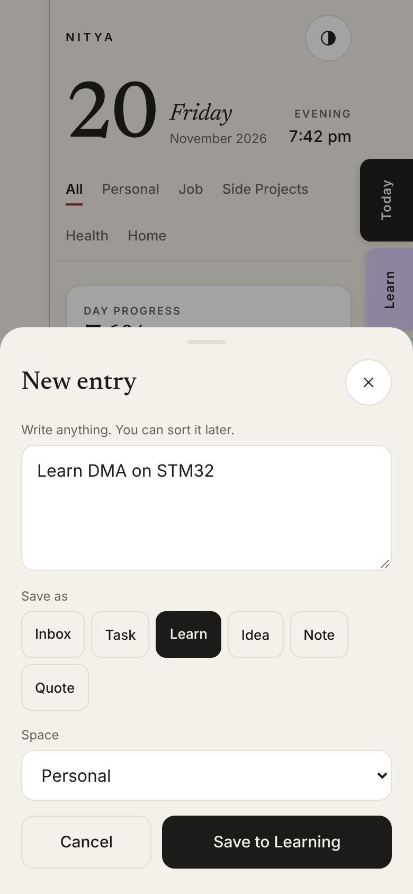<br><sub>New entry</sub></td>
  </tr>
  <tr>
    <td align="center">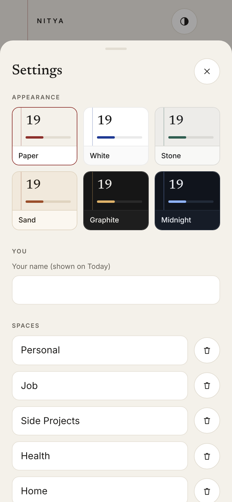<br><sub>Settings</sub></td>
  </tr>
</table>
<p align="center">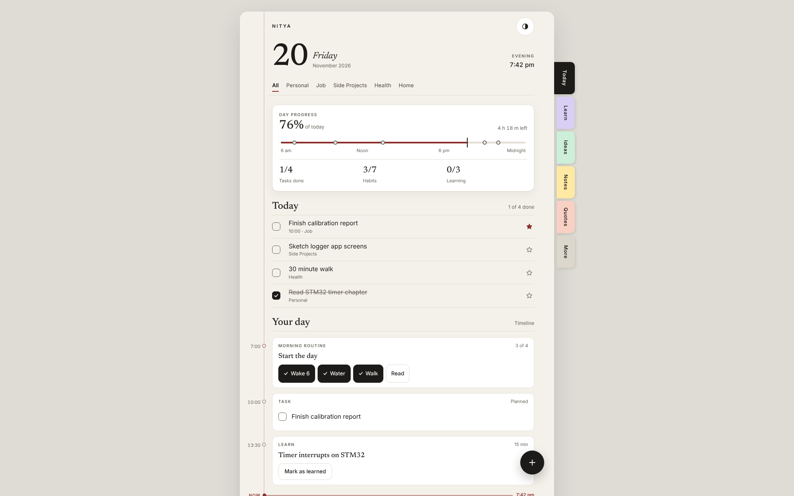<br><sub>On a Windows PC</sub></p>
</details>

---

## 📲 Install

You don't download this app from a store. You open a link and add it to your device. It takes about 30 seconds.

**App link:** https://madhavlathigara.github.io/nitya/

### iPhone
1. Open **Safari** and go to **[madhavlathigara.github.io/nitya](https://madhavlathigara.github.io/nitya/)**.
   Make sure you see the **Nitya** notebook app, **not** this GitHub page.
2. Tap the **Share** button (the square with an arrow). On newer iPhones it may be inside the **⋯** menu.
3. Scroll down and tap **Add to Home Screen**. If you see **Open as Web App**, keep it on. Then tap **Add**.
4. Open **Nitya** from your home screen. It opens full screen, like a normal app.

> 💡 If you open the link from WhatsApp, Instagram or the GitHub app, it may open inside that app's browser, where "Add to Home Screen" is missing. Open it in **Safari** instead.

### Windows
1. Open the link in **Microsoft Edge** (or Chrome).
2. Click the **Install** icon in the address bar.
   Or use **⋯ menu → Apps → Install this site as an app**.
3. The app gets its own window and a Start menu icon.

### Other devices
The app runs in any modern browser. On Android, open the link in Chrome and use **⋮ → Add to Home screen**. Android has not been fully tested yet.

---

## 🚀 Quick start

1. The app starts with **example content** so it is not empty. Look around, then remove it in **Settings → Remove example content**.
2. Tap the **+** button to save anything quickly: a task, something to learn, an idea, a note or a quote.
3. Use the **tabs on the right** to move between Today, Learn, Ideas, Notes, Quotes and More.
4. Open **Settings** (◐ at the top right) to pick a colour template, rename your spaces and set your morning, revision and evening times.
5. Save a **backup** about once a week.

---

## 🔐 Your data & privacy

- Everything you enter is saved **only on your device**, in the browser's local database (IndexedDB).
- The app has **no server, no login, no analytics and no ads**. Your data is never sent anywhere.
- The website only delivers the app's code. If you share the link, each person gets their **own empty copy**. Nobody can see anyone else's data.
- Each device keeps its own data. iPhone and Windows do **not** sync with each other.
- ⚠️ If you delete the app or clear the browser's website data, your entries are deleted too. **Save a backup regularly.**
- Settings → **Turn on storage protection** asks the browser not to clear your data when the device is low on space. The browser decides if it allows this.
- The full source code is in this repository, so anyone can check what it does.

---

## 💾 Backup & restore

- **Backup:** Settings → **Back up now**. On iPhone, choose *Save to Files* (for example, iCloud Drive).
- **Restore:** Settings → **Import backup**, then pick your file. You can **Replace** the data on that device, or **Merge** the backup with what is already there.
- **Moving to a new phone or PC:** make a backup on the old device, then import it on the new one.
- **Markdown export:** Settings → **Export as Markdown** gives one readable `.md` file with your tasks, learning, ideas, goals, quotes and notes.

## 📆 Calendar

- Settings → **Export to calendar (.ics)** makes a file with your planned tasks and learning for the next 30 days.
- A single task or topic can also be exported from its own screen with **Add to calendar**.
- Open the file on your iPhone or PC to add the events to your calendar.
- This is **one way** (Nitya → calendar). Changes in the calendar do not come back to Nitya.

---

## ❓ FAQ

<details><summary><b>Is it really free?</b></summary><br>Yes. No ads, no subscription, no in-app purchases.</details>

<details><summary><b>Do I need to create an account?</b></summary><br>No. Open the link and start using it.</details>

<details><summary><b>Why is it not on the App Store?</b></summary><br>It is an installable web app (a "PWA"). It installs from the link, so no store is needed. It still gets its own icon and opens full screen.</details>

<details><summary><b>Does it work without internet?</b></summary><br>Yes. After you open it once, it works offline.</details>

<details><summary><b>Can I use it on my phone and my PC at the same time?</b></summary><br>Yes, but each device keeps its own separate data. To copy data from one device to another, use Backup and Import.</details>

<details><summary><b>How does revision work?</b></summary><br>When you mark a topic as learned, it comes back after 1 day, then 3, 7, 14, 30 and 60 days each time you revise it. Topics that are due show up on Today and in Learn → Revise. This schedule is a common practice, not a fixed scientific rule.</details>

<details><summary><b>How do I get updates?</b></summary><br>When a new version is published, open the app while you are online. Then close it and open it again. Your data stays.</details>

<details><summary><b>I deleted the app by mistake. Can I get my data back?</b></summary><br>Only if you saved a backup file. Install the app again and use <b>Import backup</b>.</details>

<details><summary><b>Is there AI or sharing?</b></summary><br>No, by choice. Nitya stays simple, free and private.</details>

---

## 🛠️ Built with

- **React 19** + **TypeScript**, built with **Vite 8**.
- **Dexie** (a small helper for the browser's IndexedDB database) to store data on the device.
- **vite-plugin-pwa** for installing and offline support.
- Fonts **Newsreader** and **Inter**, included in the app (no font requests to other websites).
- No tracking scripts, no analytics.
- Versions checked on 20 Nov 2026.

```
nitya/
├── .github/workflows/deploy.yml   # builds the app and puts it on the gh-pages branch on every push
├── public/                        # app icons
├── screenshots/                   # images used in this README
├── src/
│   ├── App.tsx                    # page shell, side tabs, + button
│   ├── styles.css                 # all styles (colours come from the colour templates)
│   ├── lib/                       # data, database, revision schedule, backup, calendar, themes
│   ├── components/                # shared pieces: dialogs, sheets, task row, settings
│   └── pages/                     # Today, Learn, Ideas, Notes, Quotes, More (+ more/ sub pages)
├── index.html
├── vite.config.ts                 # build + install (manifest) + offline settings
└── package.json
```

### Run it on your PC
Needs **Node.js LTS** (20.19 or newer).
```
npm install
npm run dev
```
Then open the address it prints (usually http://localhost:5173).

| Command | What it does |
|---|---|
| `npm run dev` | Runs the app while you change code |
| `npm run build` | Checks types and makes the final app in `dist/` |
| `npm run preview` | Runs the built app locally |
| `npm run lint` | Checks the code for common mistakes |

### Make your own copy
1. Click **Fork** at the top of this page.
2. In your copy, open the **Actions** tab, enable workflows if asked, and run **Build and publish to gh-pages**. When it shows ✓, a `gh-pages` branch appears.
3. Open **Settings → Pages**. Choose **Deploy from a branch**, then **gh-pages** and **/ (root)**, then **Save**.
4. After 1–2 minutes, your own link appears: `https://<your-username>.github.io/nitya/`

> The `main` branch has the source code. The `gh-pages` branch has the finished app, made automatically on every push. Don't edit `gh-pages` by hand.

### Notes for future changes
- **Everything is one `Item` with a `type`.** A new section later = a new type. Old data does not need converting.
- **Database changes:** add `this.version(2).stores({...})` in `src/lib/db.ts`. Never change version 1, or old data may not open.
- **Backup format** has `version: 1`. If it ever changes, keep reading old versions in `importJSON`.
- **Packages:** run `npm outdated` every few months. Update one big package at a time and test.
- **iOS rules can change** with each iOS update (storage, install). Test again after big iOS updates.

---

## 🤝 Feedback

Found a bug or have an idea? Please open an [Issue](../../issues). Suggestions are welcome.

<p align="center"><sub>Made with ❤️ in India</sub></p>
